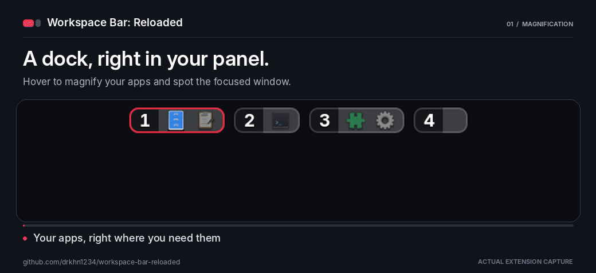
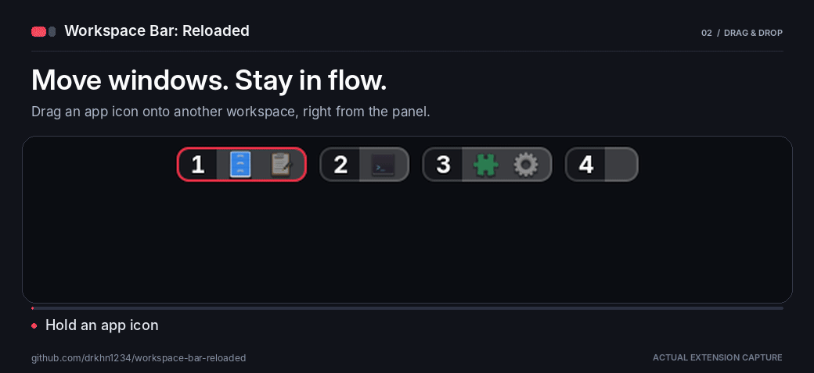
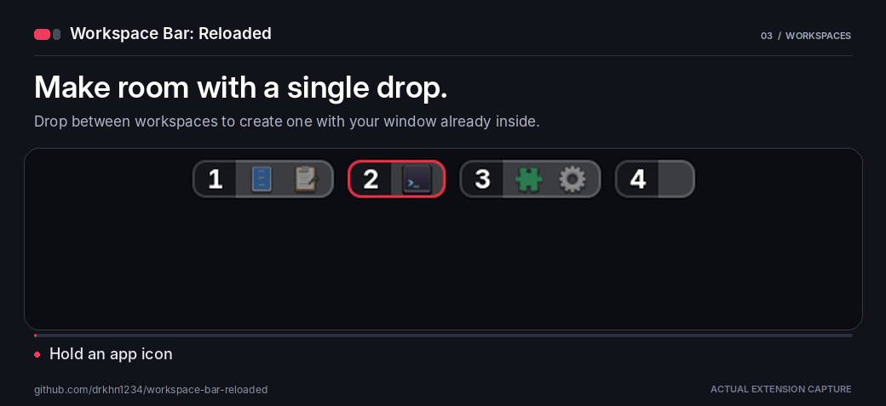
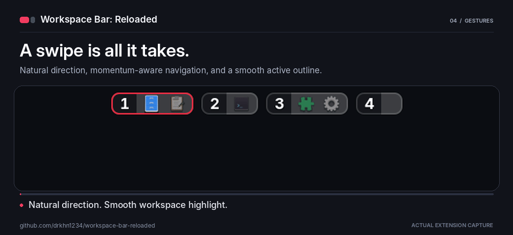

# Workspace Bar: Reloaded

Your workspaces and apps, together in the GNOME top panel. Hover to magnify, drag windows between workspaces, and navigate with touchpad swipes.

**GNOME Shell 45–51**

| Hover magnification | Move windows |
| --- | --- |
|  |  |
| **Create a workspace** | **Natural swiping** |
|  |  |

## Install

```bash
git clone https://github.com/drkhn1234/workspace-bar-reloaded.git ~/.local/share/gnome-shell/extensions/workspace-bar-reloaded@drkhn1234.github.io
cd ~/.local/share/gnome-shell/extensions/workspace-bar-reloaded@drkhn1234.github.io
glib-compile-schemas schemas/
```

Log out and back in, then enable the extension:

```bash
gnome-extensions enable workspace-bar-reloaded@drkhn1234.github.io
```

If you use the original Workspace Bar, disable it first. Your existing settings are preserved.

## Use

- **Click an app** to focus its window; **middle-click** to open a new instance.
- **Click a workspace** to switch to it; click the active workspace to toggle Overview.
- **Drag an app** onto a workspace to move its window, or between workspaces to create one.
- **Drag a workspace number** to reorder workspaces.
- **Swipe horizontally** over the bar to switch workspaces.
- **Scroll/swipe up** over an app to bring it to the active workspace; **down** to close it. Over a workspace number, these actions affect all its windows.

These are the default actions. Change them in **Gestures**.

## Customize

Open preferences from the Extensions app, or run:

```bash
gnome-extensions prefs workspace-bar-reloaded@drkhn1234.github.io
```

- **Workspace Bar:** position, size, app grouping, appearance, and animations.
- **Magnification:** presets, icon growth, spacing, and focused-app highlights.
- **Gestures:** click actions, scroll/swipe actions, and natural horizontal swiping.

Enable **Smooth Workspace Highlight** under Workspace Bar → Animation for a sliding active outline.

## Credits and license

Based on [Workspace Bar by jguece](https://gitlab.com/jguece/workspace-bar/-/tree/v11). Licensed under [GPL-3.0](LICENSE).

[Contributing](CONTRIBUTING.md) · [Report an issue](https://github.com/drkhn1234/workspace-bar-reloaded/issues)
